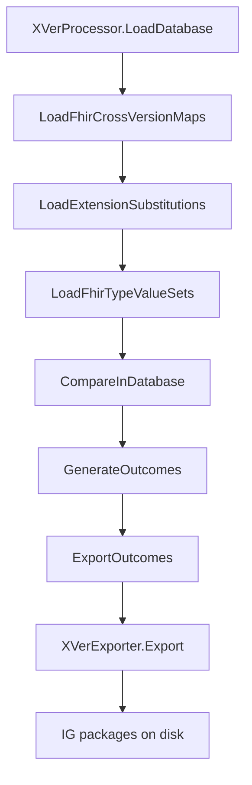
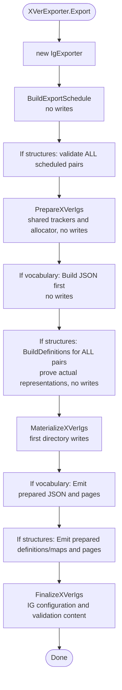

# XVerExporter.Export Specification

## Executive Summary

`XVerExporter.Export` is the primary entry point for materializing the
cross-version FHIR artifacts the pipeline produces (Implementation Guides,
StructureDefinitions, ValueSets/CodeSystems, ConceptMaps, page content)
onto disk. It does **not** compute outcomes — those are already in the
SQLite comparison database by the time it runs — it walks the
already-computed `DbStructureOutcome` / `DbValueSetOutcome` /
`DbValueSetConceptOutcome` rows and emits the FHIR JSON and IG markdown
for each one.

`XVerExporter.Export` instantiates an `IgExporter`, computes its write-free
schedule, validates every scheduled structure pair's persisted completion and
decisions, and prepares/builds all requested vocabulary and structure definitions
**before** materializing any IG/output directories. It then emits the prepared
content (one cross-version IG per pair plus validation IGs per allowed package)
and dispatches the page exporters:

- `VocabularyFhirExporter` — writes CodeSystem, ValueSet, and ConceptMap
  JSON for each cross-version IG.
- `VocabularyPageExporter` — writes the value-set lookup and index
  markdown pages for each cross-version IG.
- `StructureFhirExporter` — writes Extension and Profile
  StructureDefinitions plus the supporting ConceptMaps for resource,
  type, and element mappings.
- `StructurePageExporter` — writes the resource/type lookup index pages
  and per-resource/per-type lookup pages.

`IgExporter.FinalizeXVerIgs` then writes `ig.ini`, `ig.json`, and
`menu.xml` for each tracked IG, closing out the package skeletons.

**File:** `src/Fhir.CodeGen.Comparison/Exporter/XVerExporter.cs:63`
**Class:** `XVerExporter` (in `Fhir.CodeGen.Comparison.Exporter`)
Representation and serialization work lives in the delegated builders/exporters;
the orchestration retains all prepared plans until preflight succeeds.

## Architecture Overview

### Pipeline position



`XVerExporter.Export` is the seventh and final step of the cross-version
pipeline. It assumes the comparison database is loaded and the outcome
tables (`DbStructureOutcome`, `DbValueSetOutcome`,
`DbValueSetConceptOutcome`) are populated. It does not perform any
comparison or outcome generation.

### Component layout

```text
XVerExporter (orchestrator)
├── IgExporter
│   ├── BuildExportSchedule  → exact pair/validation schedule, no writes
│   ├── PrepareXVerIgs       → shared paths/trackers/allocator, no writes
│   ├── MaterializeXVerIgs   → creates/resets directories after all builds
│   └── FinalizeXVerIgs        → writes ig.ini, ig.json, menu.xml
├── VocabularyFhirExporter.Build(tr) / Emit(files)
│       → prepare JSON first, then write the same CodeSystem/ValueSet/ConceptMap files
├── VocabularyPageExporter.Export(tr)
│       → per-IG: index-vs.md, lookup-vs-*.md
├── StructureFhirExporter.BuildDefinitions(igTr) / Emit(igTr, definitions)
│       → prepare all pairs first; emit those definitions and resource/type/element maps
└── StructurePageExporter.Export(tr)
        → per-IG: resource and type lookup index pages,
          per-resource/per-type lookup pages
```

### Core dependencies

- **Database layer:** `IDbConnection` (SQLite) holding the populated
  outcome tables produced by `GenerateOutcomes`.
- **Configuration:** `ConfigXVer` (output paths, cross-version source
  path, version overrides, per-FHIR-version export flags
  `ExportR2`..`ExportR6`, `XverArtifactVersion`, `XverIncludeScripts`).
- **FHIR libraries:** `Hl7.Fhir.Model`, `Hl7.Fhir.Serialization`.
- **Outcome readers:** `DbStructureOutcome`, `DbValueSetOutcome`,
  `DbValueSetConceptOutcome`, and the lower-level `DbStructureDefinition`
  / `DbElement` / `DbElementType` / `DbValueSet` rows for resolving
  source and target details.

## Method Signature

```csharp
public void Export(
    bool includeIgScripts = true,
    bool processVocabulary = true,
    bool processStructures = true,
    int? maxStepSize = null,
    HashSet<(FhirReleases.FhirSequenceCodes s, FhirReleases.FhirSequenceCodes t)>? specificPairs = null)
```

### Parameters

| Parameter | Default | Purpose |
|---|---|---|
| `includeIgScripts` | `true` | Whether `IgExporter.MaterializeXVerIgs` emits publisher batch/shell scripts alongside the IG sources. |
| `processVocabulary` | `true` | When `true`, run `VocabularyFhirExporter.Export` and `VocabularyPageExporter.Export`. |
| `processStructures` | `true` | When `true`, run `StructureFhirExporter.Export` and `StructurePageExporter.Export`. |
| `maxStepSize` | `null` (= all) | Forwarded to `IgExporter.BuildExportSchedule`. Limits pair distance in package-list index; defaults to package count minus one. |
| `specificPairs` | `null` (= all) | Forwarded to `IgExporter.BuildExportSchedule`. Only listed directed `(source, target)` sequence pairs are scheduled. |

### Constructor

```csharp
public XVerExporter(IDbConnection db, ConfigXVer config)
```

- `_outputPath` is taken from `config.OutputDirectory`.
- `_crossVersionSourcePath` is taken from `config.CrossVersionMapSourcePath`
  (null if empty); this is where `xver-package-config.json` and
  `igParameters.json` are read from later by `IgExporter`.
- `_crossDefinitionVersion` defaults to `config.XverArtifactVersion`, or
  `"0.1.0"` if that's empty. `IgExporter`'s constructor may later
  override this from the on-disk `xver-package-config.json` if the
  configured version was empty.
- `_versionSpecificExtBehavior` is fixed to `ShortVersion`
  (XVerExporter.cs:45).
- `_versionSpecificExport` is fixed to `TargetVersion`
  (XVerExporter.cs:46). This is read by the vocabulary and structure
  exporters to decide which `ConceptMapToR3` / `ConceptMapToR4`
  serialization shims to apply when emitting back-version content.

### Exceptions

`XVerExporter.Export` rejects missing/incomplete/incompatible/stale catalog,
input, comparison or outcome state, and unsupported actual
scheduled representations, before any IG/vocabulary/output writes when structures
are requested. Later materialization/emission/finalization can still fail; this
is preflight, not transactional rollback of all possible export errors.
An invalid persisted profile-decision envelope warns and excludes its directed
pair from the export schedule. Other verified pairs can still export.

## Detailed Algorithm

The orchestration in `XVerExporter.Export` is:

1. **Construct `IgExporter`** with `_db`, `_loggerFactory`, `_outputPath`,
   `_crossVersionSourcePath`, `this` (the `XVerExporter` instance, so the
   child exporters can read its `_crossDefinitionVersion` and version
   knobs), and `_config`.
2. **Build schedule and validate persisted prerequisites.** Call
   `igExporter.BuildExportSchedule(maxStepSize, specificPairs)`. If
   `processStructures`, call `UnsafeCodeInputStore.RequireExportReady` on
   **all** `schedule.PackagePairs`.
3. **Prepare/build without writes.** `PrepareXVerIgs(schedule)` returns the
   shared `XVerExportTrackingRecord` with per-pair and validation trackers
   and planned paths. When requested, `VocabularyFhirExporter.Build(tr)` runs
   **first**, preserving vocabulary-first `GetName` allocation and selections.
   Then one `StructureFhirExporter` calls `BuildDefinitions(igTr)` for **every**
   scheduled pair, caching target Extension value types/reference inventories,
   constructing extensions/resource profiles and checking actual representations.
   Retain these exact definitions, trackers, allocator state and
   `EdOutcomeMapTargets`; do not allocate/build them again on emission.
4. **Materialize and emit only after all builds succeed.**
   `MaterializeXVerIgs(tr, includeIgScripts)` creates/resets directories and copies
   support content. If vocabulary is requested, emit the prepared JSON with
   `VocabularyFhirExporter.Emit`, then run `VocabularyPageExporter.Export(tr)`.
   If structures are requested, call `StructureFhirExporter.Emit` with each
   prepared pair/definition plan (extensions, profiles and resource/type/element
   maps), then `StructurePageExporter.Export(tr)` for resource/type indexes and
   lookup pages. Resource-to-Basic handling still emits `Basic.code.coding` slices
   where applicable; eligible Quantity profiles do not enter that resource path.
5. **Call `igExporter.FinalizeXVerIgs(tr)`**. For
   each tracked XVer IG, write `ig.ini`, `ig.json`, and `menu.xml`. For
   each tracked validation IG, write the validation-example bundle plus
   `ig.ini`, `ig.json`, and `menu.xml`.

The public content-export wrappers/page exporters consume the shared
`XVerExportTrackingRecord`; orchestration instead passes each prepared structure
tracker/definition plan to `Emit`. Content work covers `tr.XVerIgs`, not validation
IGs.

### `IgExporter.BuildExportSchedule` package-pair generation

This is the only non-trivial scheduling decision in the pipeline and
worth surfacing here because every downstream exporter walks the
resulting pair list. The public `CreateInitialXVerIgs` signature remains a
prepare/materialize wrapper; `XVerExporter.Export` instead uses the explicit
split so all definition builds precede materialization:

1. Load local `packages` via `DbFhirPackage.SelectList(..., orderByProperties: [nameof(DbFhirPackage.PackageVersion)])`.
2. `maxStepSize ??= packages.Count - 1`.
3. For `stepSize` in `1..maxStepSize`:
   - For each `i` in `0..(packages.Count - stepSize - 1)`:
     - `sourcePackage = packages[i]`, `targetPackage = packages[i + stepSize]`.
     - If `_allowedExportVersions` contains `targetPackage.DefinitionFhirSequence`
       *and* (`specificPairs` is null or contains the forward pair):
       append `FhirPackageComparisonPair(sourcePackage, targetPackage)`.
     - If `_allowedExportVersions` contains `sourcePackage.DefinitionFhirSequence`
       *and* (`specificPairs` is null or contains the reverse pair):
       append `FhirPackageComparisonPair(targetPackage, sourcePackage)`.
4. Record the resulting pair list in the schedule. `PrepareXVerIgs` uses
   `prepareXVerIg` per pair; `MaterializeXVerIgs` later creates directories and seeds a per-IG
   `.gitignore` at the IG root, copied from
   `<crossVersionSourcePath>/input/ig-support/gitignore.txt` when that file
   exists and the destination has none.
5. Build `targetFhirVersions` from `specificPairs.t` (filtered by
   `_allowedExportVersions`) if `specificPairs` is non-null.
6. For each package in `packages`: skip unless it's in
   `_allowedExportVersions` (and in `targetFhirVersions` when filtering);
   otherwise add it to the validation schedule, prepare it with
   `prepareValidationIg`, and materialize its directories/support files later.

The stepped algorithm means closer-version pairs are emitted first
within the tracking record's `XVerIgs` list. Downstream exporters
preserve that order.

Scheduling, preparation and definition building create no output directory.
Preflight uses exactly this schedule, not a second approximation of
version flags, pair filters, or step windows. It checks compatible feature
schema/format, completed full inventory (format **1**, policy **2**), completed
input revision (format **2**) bound to that inventory, comparison revision against
that input, safety-outcome stamps (format **2**) and recomputed persisted negative
decisions. A completed zero-trigger result is valid only after classifying all
required profile facts; absent rows/stamps are not proof of safety.
Failure is read-only and protects existing IG sentinel content from the
materializer's destructive directory reset as well as preventing fresh
output creation. A later invalid pair blocks the entire scheduled structure
export before even vocabulary output in a combined run. Definition construction
preflights the actual all-pair schedule too, so a later-pair representation failure
also precedes writes. Vocabulary-only export bypasses structure prerequisites,
does not construct `StructureFhirExporter`/the structure catalog and never creates
missing safety state.

Old caches are not migrated or automatically recomputed. Diagnostics name
the existing load → compare → outcomes → export recovery sequence.
Unrelated database errors retain their cause. Explicit reload-enabled
`export` runs those prerequisites in `XVerProcessor` before entering this
method; a non-reload export remains an error on stale state.

### `IgExporter` configuration loading

The `IgExporter` constructor (`IgExporter.cs:437-546`) does three
things relevant to `Export`:

1. Populates `_allowedExportVersions` from `config.ExportR2`..`ExportR6`.
   Versions whose flag is false are silently excluded from both the
   cross-version IG list and the validation IG list.
2. Calls `loadIgParams()` and `loadPackageExportConfig()`, which read
   `<_crossVersionSourcePath>/input/ig-support/igParameters.json` and
   `xver-package-config.json` respectively if those files exist. Missing
   files are silently ignored (the IG ships with default parameters).
3. If `_xverPackageExportConfig?.PackageVersion` is set *and* the
   user-supplied `config.XverArtifactVersion` was empty, overrides
   `_exporter._crossDefinitionVersion` with the on-disk value.
4. If `_xverDependencies` is still empty after loading, falls back to a
   hard-coded default trio: `hl7.terminology@7.1.0`,
   `hl7.fhir.uv.extensions@5.3.0`, `hl7.fhir.uv.tools@1.1.2`
   (`IgExporter.cs:515-543`). These appear as IG dependencies in the
   generated `ig.json`.

## Mermaid Workflow Diagram



## Typed Construction and Instance Invariants

`StructureFhirExporter.BuildDefinitions` constructs definitions in memory:
extensions first, then already-scheduled resource profiles. `BuildExtensions`/`BuildProfiles` share
`ProfileRepresentationIndex` decisions with the actual differential
builder. Definition writes and logging remain in the emission shell; vocabulary JSON
serialization is write-free build work. Construction order, `GetName` allocation,
generated IDs/URLs, and `EdOutcomeMapTargets` mapping provenance are
preserved.

Typed steps describe native members, narrowed choices, generated or
modifier extensions, fixed child-extension URLs, value types, repeated
content references, and resource-owner transitions. The index records
native fields even when unchanged fields are omitted from the differential,
and composes datatype locations at every actual use site. Extension
attachments use the same decisions as construction, including cardinality
overflow, Basic fallback, parent/nested contexts, and substitutions; the
renderer never guesses a URL from an element suffix.

### Construction and Projection

Outcomes and native projection share internal
`UnsafeCodeBindingScopeResolver` / `UnsafeCodeBindingScope` facts and the
pure `UnsafeCodeEvidenceApplicability` matcher. Each stage caches frozen
facts within its package-pair lifetime, including canonical/ValueSet
versions, aggregate and per-canonical member slices, required-binding and
completeness facts; regeneration creates a fresh resolver. Member identities
keep code-system versions separate from ValueSet versions. The resolver
receives pair-local ValueSets and a member-access delegate, not a database,
configuration reader, or path walker.

Outcomes retain effective-binding selection, precise versus potential
evidence, primitive qualification and policy classification. The index
retains actual native/extension attachment decisions and passes each native
location's actual source and target enclosing binding elements to matching.
Both map endpoints must pass independently:

- **Direct binding:** preserve the conservative canonical check: a non-null
  map URL equals the direct binding URL, and a supplied map ValueSet version
  equals the binding version (an absent map version is a wildcard). Resolved
  terminology membership is not required for this existing safety check.
- **Imported scope:** require a resolved imported URL match, an exact
  ValueSet-version match when supplied (otherwise a wildcard), and the
  endpoint's qualified system/code in **that scope's own** member slice,
  using existing system-version overlap rules. Aggregate outer or
  sibling membership cannot supply this proof. Missing source qualification
  uses the shared complete, uniquely scoped identity proof; missing imported
  target qualification is not inferred from another scope.

Direct/imported mixed endpoints are valid only when each passes its own
branch. Unscoped map URLs remain native nonmatches; candidates require
concrete source and target codes and must not be `ExplicitNoMap`.
`SourceBinding` continues to mean the enclosing binding, not the imported
map scope. Generated extension locations retain empty native transformation
lists. The separate `BindingMembers` / `PreservesQualification` proof for
erased carriers remains unchanged: imported applicability is not proof that
an erased system or version can be recovered.

### Selected datatype values and legacy H2 paths

`ResolveSafety` normalizes the terminal declared datatype-value endpoint
before the shared `ResolveOccurrence` walk. Ordinary `Resolve` and
`Occurrences` still use that same core and shared `BuildLocations` without
source selection. The endpoint contributes no member, repeat, resource
owner, recursion edge or direct-use change. Incoming typed-child prefixes,
binding contexts, ordinary attachments and owner discovery retain their
existing meaning.

Selection restricts final **source** enumeration before carrier/state
construction. Effective rows are reconciled with effective aggregate
declarations/count through the base chain; an available Coding row cannot
hide aggregate code. Complete rows with unique exact source roots are the
normal proof. Aggregate-only unprofiled declarations may supply a unique
root fallback, but missing/conflicting metadata cannot certify absence.
Profile roots resolve by source package, canonical/version and structure
identity, never the first matching basename. Actual target comparisons
and declared target rows determine target types; a source profile canonical
is never rendered in `ofType(...)`.

Every applicable selected native/extension attachment survives, including
failed states. Missing selected comparisons/roots, explicit unmapped
selected types, opaque attachments and identity-erasing/unsupported
substitutions remain failures. Observable Coding cannot excuse another
failed attachment. Enclosing bindings, `MatchProjection`,
`BindingMembers`/`PreservesQualification`, native transformations and H1
responsible-map provenance are unchanged. The emitter calls safety
resolution only, rejects an empty result and validates every location; it
does not qualify primitives, read policy or skip unsupported carriers.

An active legacy broad Coding/boolean path may select Coding **in memory
only**, on complete source proof, retaining the persisted path and old key.
A broad Coding/code path returns `AmbiguousSourceUse`, including when code
is declared only in aggregate metadata. Completion stamps do not prove
independent primitive qualification. Incomplete/conflicting legacy H2
facts and malformed selected endpoints fail contextually. Diagnostics keep
the original path, qualified identity and provenance and end:
`Regenerate load, compare, outcomes, and export after resolving the source-value representation.`
Single-use/unaffected paths and empty plan input retain their behavior.
Selected-endpoint compatibility handling itself introduces no export-side writes,
migration, policy reclassification or rewrite-on-read. The active catalog contract
separately requires compatible input/outcome format 2.

New selected paths round-trip through existing `SourcePathJson` and
`ReadConstraintPlans`, while context element IDs remain the original map
IDs. Coding/code produces distinct deterministic Coding and primitive
invariants. Its qualified two-rule fixture has **three active plans**:
two typed Coding identities (null SourceVersion; the version-qualified
identity requires runtime Coding.version), and one primitive identity
qualified as `urn:example:primitive|primitive-v1#unsafe` from the original
choice binding. The ValueSet version remains distinct from system version.
Older binaries cannot consume the new endpoint semantics safely; regenerate
with a compatible producer before downgrade. JSON/schema compatibility is
not binary semantic compatibility.

`UnsafeCodeInputStore.ReadConstraintPlans` reads persisted triggers and
provenance once per pair at `BuildProfiles` completion
(`StructureFhirExporter.cs:1324-1327`, `DbUnsafeCodeClasses.cs:162-190`).
`UnsafeCodeConstraintEmitter` has no database or configuration reader and
does not reclassify policy or exclusions. It groups semantic occurrences,
unions observable representations, sorts/deduplicates predicates, and
appends error-severity invariants to the existing resource-root
differential. Stable `xv-unsafe-code-<digest>` keys use semantic profile,
direction, owner, and source-path identities, never DB keys or timestamps;
key collisions fail explicitly.

Native transformations come from pair map evidence, **not** a trigger's
`EvidenceKeysJson`: an independently eligible ordinary rule can persist an
active trigger with no map evidence keys. Transformations are grouped by
their six source/target system/version/code identity fields and retain an
immutable union of responsible-map provenance, deduplicated and sorted by
filename, ConceptMap id/canonical and group/source/target indices. Policy
classification and persisted trigger/rule provenance remain distinct from
the maps responsible for a representation's identity change.

Each existential trigger implies that the **containing instance's**
`implicitRules` contains exactly
`https://hl7.org/fhir/implicit-rules/omitted-mandatory-interversion-code`.
Safe-only, exempt, and absent-code instances pass this invariant without
the URI. Unsafe-only or mixed repetitions fail with missing/wrong URI and
pass with the exact URI. Coding system/version/code predicates stay on the
same occurrence. Collection-safe `where(...).exists()` yields a Boolean,
not empty optional-value equality; `first()` cannot mask unsafe repetitions.
Primitive metadata-only `_op.extension` remains reachable without scalar
`op`.

Recursive selectors include the initial occurrence and descendants.
Resource-valued transitions use symbolic closure over the finite union
of typed owner edges, not expanded cycle trails. Each reached owner is
filtered/checked using **its own** `implicitRules`; a parent cannot satisfy
a child, nor vice versa. External resource references are not followed.
Same/mutual recursion and owner-closure growth are covered by existing
deep instance tests.

An applicable identity that cannot be qualified is a blocking **outcome**
error. An active classified trigger that cannot be projected precisely is
a blocking **export construction** error: missing representations,
identity-erasing native transformations, erased versions, ambiguous
primitive systems, and opaque external substitutions are not permission to
broaden or omit a constraint. Diagnostics include profile canonical,
direction, source element/type-use path, qualified code, and provenance.
For an applicable native transformation whose source matches the active
trigger, any source/target system, system-version or code change blocks
construction with `"identity-changing native code mapping"` and separate
`Responsible map provenance`. This applies to imported native Coding maps
as well as direct maps; distinct outer/imported ValueSet identities alone
do not justify rejection of an identity-preserving map. No target-code
predicate substitution, runtime conversion or trigger omission repairs an
identity change.
State preflight and all scheduled definition-construction/projection checks happen
before IG/vocabulary/output writes. Later I/O, map/page emission or finalization
errors are not covered by transactional rollback.

The StructureDefinition's own `implicitRules` remains **unset**. Passing
this new invariant does not assert that all bindings/cardinalities or
other constraints pass, and does not relax them. The separately approved
four R4B minima below are the sole characterized cardinality exception.
R4/R4B tests evaluate expressions recovered from serialized profiles
against target-release typed instances; the existing R3 conversion branch
also preserves constraint key/severity/human/expression/source.

## Quantity Profile Membership and Bounded Representation

The catalog stores all retained normalized profiles, but standalone export uses
operational owners on both sides: existing native behavior/exclusions plus Profiles
with ordinal declared `Type == "Quantity"` and unique acyclic ancestry to the
actual same-package native Quantity. Profiles on Age, Coding and resources remain
passive. They may constrain legitimate uses without receiving standalone files,
map membership or lookup pages.

Eligible Quantity profiles use **datatype-style** type/element maps, type indexes,
lookup pages and per-element extensions when scheduled. They are not resources,
do not enter resource maps/indexes or Basic fallback, and do not automatically
receive standalone datatype profiles. `BuildProfiles` deliberately skips datatypes.
No imported or negative profile is permission to advertise a nonexistent generated
URL. Native references verify exact target definition/version and effective facts;
a missing profile cannot fall back to unprofiled Quantity or basename matching.
Vocabulary build/emission preserves selection policy and semantics. Import-time
R5 pruning isolates unrelated passive bindings; terminology retained for an
operational/referenced constraint is an intentional possible output change
([inventory contract](./xver-load-database.md#inventory-completion-reuse-and-costs)).

`prepareDefinitions` recomputes pair-local `ProfileUseFacts.ClassifyPair` decisions.
`RequireScheduledUse` checks actual scheduled owners/uses, not every stored
definition indiscriminately. A complete `Unrepresentable` outcome is retained as
negative evidence, never Equivalent, preserved restrictions, fake unsafe-code
qualification or a usable target. It blocks an unsupported scheduled use, while
unrelated unscheduled negatives need not block a proven Range consumer. Missing,
malformed and unclassified required semantics produce warnings, not accepted negatives.

`ProjectScheduledUses` can re-prove a negative as `OwnerProjection` only inside an
already-scheduled resource profile, with exact target owner/occurrence and complete
permitted-alternative-union safety. `ApplyProjection` then carries the proved
restrictions into that differential without mutating native definitions or
persisted negative envelopes. Extension-only projection remains unsupported;
extension values require proven native reuse and legal target Extension value
types. This is not a general projection promise.

The actual-core bounded census is 3,604 decisions: 284 native reuses, zero owner
projections, 3,320 structured negatives and zero unresolved. It is not a whole-core
comparer/export success or universal impossibility claim. In particular R5 Range
bounds reuse exact `SimpleQuantity|4.3.0` with comparator max 0 and native `sqty-1`;
R5 comparator `ad` and DSTU2 Age zero-value differences have persisted negative
consumer tests with conservative manually arranged ordinary rows.
`PersistedRangePipelineRetainsQuantityRestrictionsAndNoPassiveArtifacts` separately
runs the real element/type comparer and element outcome generator for actual Range
and its local carrier, with four physical database reopens. Its structure envelopes
and artifact schedule are authored; it is not a whole-core structure-comparer run.

### Representative stable output diff (fixture-based)

These are **selected-field/text additions**, not a captured real-core byte diff.
`CrossVersionArtifactSemanticTests.OperationalQuantityMapsAndPagesRemainDatatypesAcrossProfileClassMovement`
uses `CreateProcessingEligibilityInputs` and authored local maps to exercise
Profile ↔ ComplexType movement. In its R5 → R4B direction, the emitted type map
and linked type-lookup page contain:

```diff
 input/resources/R5-type-map-to-R4B.json — selected group.element fields
+ {"code":"SimpleQuantity","target":[{"code":"SimpleQuantity","equivalence":"wider"}]}
 input/pagecontent/index-types.md
+| [R5 SimpleQuantity](https://hl7.org/fhir/R5/datatypes.html#SimpleQuantity) | [R4B SimpleQuantity](https://hl7.org/fhir/R4B/datatypes.html#SimpleQuantity) | [XVer Lookup: SimpleQuantity](lookup-sd-SimpleQuantity.html) |
```

The same real artifact assertions require SimpleQuantity's `index-types.md` row
to use `datatypes.html#SimpleQuantity`, preserve
`Quantity:simplequantity.code` in its element map, and forbid SimpleQuantity and
OrphanQuantity in the resource map/index. OrphanQuantity is a fixture-only eligible
profile without a direct target: its type lookup points to Extension, not Basic.
No standalone datatype profile is built; PassiveAge/PassiveCoding/PassiveValueSet
and the fixture's passive MoneyQuantity appear in no emitted JSON/markdown.

Separately, `UnsafeCodeProfileTests.PassiveProfileAlternativesRetainTheirOwnConstraintsAndExactNativeReferences`
asserts these selected **normalized construction JSON** fields for a constructed
Extension value in its R5 → R4 fixture (not a claimed target-file byte diff):

```diff
 Extension.value[x].type — exact target-native alternative references
+ [{"code":"Coding","profile":["http://example.org/StructureDefinition/Coding-a|4.0.1","http://example.org/StructureDefinition/Coding-b|4.0.1"]}]
```

Both referenced passive target definitions retain their own fixed code (`a` or
`b`); neither is exported as a new profile. The versions are definition versions,
not inferred release suffixes. The actual-core Range proof above independently
verifies native SimpleQuantity facts; it is not fabricated output from this fixture.

Intentional constrained-output changes also include restrictions projected into
already-generated resource profiles. Committed
`ScheduledResourceOwnerEmitsProjectedTypedRestrictionsInTheTargetVersion` checks
serialized R4/R4B occurrence cardinality, fixed code, pattern system, required
versioned binding and the `selected-1` invariant at `Parameters.parameter.value[x]`,
with focused valid/invalid target-instance checks. These are not merely recovered
`xv-unsafe-code-*` expression assertions or full-validator acceptance claims.

## Measured Imported Native Mapping Contract

Measured on `2026-11-06` for R5 → R4 (`4.0.1`) and R5 → R4B (`4.3.0`),
with production baseline
`e153f6ef797a0194b8a36ca1994818a07e08140e` before the correction. The staged
fixture uses the actual native `ValueSet.jurisdiction` CodeableConcept and
its `ValueSet.jurisdiction.coding` occurrence. Distinct source/target outer
ValueSets compose-import uniquely resolved same-package inner
`url|ValueSet-version` scopes; all relevant ValueSets have `CanExpand == false`.
The combined map's own inner members are
`urn:example:source|system-version-7#unsafe` →
`urn:example:target|system-version-7#changed`.

Ordinary independent input `input/ig-support/unsafe-code-mappings.json`,
entry 0 (`{"system":"urn:example:source","code":"unsafe"}`), produces an
active persisted wildcard-version trigger with empty map `EvidenceKeysJson`.
Each projection probe is an independently staged twin with only that rule
absent and zero triggers. Tests assert semantic correspondence of binding,
map, comparison and representation-affecting outcome state, and the same
native path/types/enclosing bindings; they do not delete the main trigger.

On the baseline, both main builds succeeded and both corresponding probes
retained no transformation. The exact recovered serialized condition was:

```fhirpath
($this.jurisdiction.coding.where($this.code.where($this = 'unsafe').exists() and $this.system.where($this = 'urn:example:source').exists()).exists() implies implicitRules.where($this = 'https://hl7.org/fhir/implicit-rules/omitted-mandatory-interversion-code').exists())
```

Strict target-release typed-instance evaluation returned exactly one Boolean
for this condition: changed target Coding without the URI → **true**;
configured source Coding without the URI → **false**. These are measured
baseline observations of this newly emitted condition, not whole-profile
validity or a permanent baseline behavior guarantee.

| Direction | Baseline combined identity change | Corrected active identity changes | Identity-preserving imported control | Active source-nonmember control |
|-|-|-|-|-|
| R5 → R4 | Construction succeeds; changed/no URI true, source/no URI false | Construction rejects all four changes; probe retains map | Construction succeeds; one retained map | Construction succeeds; no retained map |
| R5 → R4B | Construction succeeds; changed/no URI true, source/no URI false | Construction rejects all four changes; probe retains map | Construction succeeds; one retained map | Construction succeeds; no retained map |

The four corrected cases are combined system/code, code-only, system-only
and system-version-only changes. Each zero-trigger probe retains the
applicable transformation and its map provenance, while the active main
build rejects and leaves persisted triggers unchanged. No affected corrected
profile exists to recover or publish; the intentional output delta is
construction rejection, **not** a rewritten target predicate.

The exact diagnostic assertions retain profile
`http://hl7.org/fhir/5.0/StructureDefinition/profile-ValueSet`, direction
`R5->R4` or `R5->R4B`, the serialized source/type-use path
`ValueSet` / `ValueSet.jurisdiction` / `CodeableConcept.coding`, qualified
trigger `urn:example:source|*#unsafe`, and the independent rule filename/entry.
The reason is `identity-changing native code mapping`; separate
`Responsible map provenance` identifies:

| Direction | Map filename | ConceptMap id | ConceptMap canonical | Group/source/target indices |
|-|-|-|-|-|
| R5 → R4 | `input/codes/ConceptMap-R5-imported-native-R4.json` | `imported-native-R5-R4` | `http://example.org/ConceptMap/imported-native-R5-R4` | 0/0/0 |
| R5 → R4B | `input/codes/ConceptMap-R5-imported-native-R4B.json` | `imported-native-R5-R4B` | `http://example.org/ConceptMap/imported-native-R5-R4B` | 0/0/0 |

Input paths above use `/` for display. The diagnostic ends:
`Regenerate load, compare, outcomes, and export after resolving the source-value representation.`

Both active controls retain the baseline expression and unchanged
key/severity/human/source. Unsafe missing/wrong URI → false; exact URI →
true; safe-only/absent → true; mixed repetitions without URI → false
(with the exact URI → true). The profile's own `ImplicitRules` remains null.
The nonmember control keeps the unsafe source in a sibling outer include,
not the mapped inner scope, so its active trigger is enforced without
borrowing that imported transformation.

Committed tests `ImportedIdentityChangingNativeMapBlocksConstruction`,
`ImportedIdentityPreservingNativeMapEnforcesImplicitRules` and
`ImportedSourceNonmemberDoesNotAcquireNativeTransformation` assert this
matrix. Target member/ValueSet-version/system-version and actual-context
controls, extension isolation, and reversed/repeated evidence tests also
preserve scope-local applicability and deterministic responsible provenance.
Existing `NoFeatureDefinitionsMatchCharacterizedOutput` and
`AssertOnlyConstraintDelta` compare constructed/serialized definitions in
memory after date normalization (removing only the added unsafe constraint
for the latter). Those focused checks preserve naming, cardinalities, slice
URLs, extension attachment and unaffected serialization; they are not a
claim of broader Release/full-suite verification. This correction adds no
public API, persisted format, dependency or CLI change.

## Measured Filter Artifact Diff

Re-measured on `2026-11-05`, after the owner-closure and explicit-primary-key
fixes, by
`UnsafeCodeProfileTests.NativeAndExtensionOccurrencesEnforceExactImplicitRules`.
The fixture runs production load → comparison → outcomes → construction
for R5 → R4 (`4.0.1`) and R5 → R4B (`4.3.0`), with annotations plus the
configured `filter-operator#exists` rule. Both serialized expressions
still contain **2,338 characters and nine implications**.

These are complete feature deltas against the no-feature artifacts
(`CreateNoFeatureInputs`); `AssertOnlyConstraintDelta` removes only the new
root constraint and normalizes dates, then compares every profile and
extension field to the characterized JSON. The `extension` selectors below
use the actual constructed canonical, not an illustrative attachment.
The native `.value` alternative comes from the authored secondary element
mapping, not a new inference about code spelling.

R5 → R4, `StructureDefinition-profile-ValueSet.json`, canonical
`http://hl7.org/fhir/5.0/StructureDefinition/profile-ValueSet`, append at
`differential.element[id = "ValueSet"].constraint` (previously absent):

```diff
+ {
+   "key": "xv-unsafe-code-f35715412d78ebd024235024db504128",
+   "severity": "error",
+   "human": "Using an unsafe cross-version code requires the omitted-mandatory-interversion-code implicit rule.",
+   "expression": "($this.compose.include.filter.extension.where(url = 'http://hl7.org/fhir/5.0/StructureDefinition/extension-ValueSet.compose.include.filter.op').value.ofType(code).where($this.where($this = 'exists').exists()).exists() implies implicitRules.where($this = 'https://hl7.org/fhir/implicit-rules/omitted-mandatory-interversion-code').exists()) and ($this.compose.include.filter.extension.where(url = 'http://hl7.org/fhir/5.0/StructureDefinition/extension-ValueSet.compose.include.filter.op').value.ofType(code).where($this.where($this = 'unresolved').exists()).exists() implies implicitRules.where($this = 'https://hl7.org/fhir/implicit-rules/omitted-mandatory-interversion-code').exists()) and ($this.compose.include.filter.extension.where(url = 'http://hl7.org/fhir/5.0/StructureDefinition/extension-ValueSet.compose.include.filter.op').value.ofType(code).where($this.where($this = 'unsafe-demo').exists()).exists() implies implicitRules.where($this = 'https://hl7.org/fhir/implicit-rules/omitted-mandatory-interversion-code').exists()) and ($this.compose.include.filter.op.where($this.where($this = 'exists').exists()).exists() implies implicitRules.where($this = 'https://hl7.org/fhir/implicit-rules/omitted-mandatory-interversion-code').exists()) and ($this.compose.include.filter.op.where($this.where($this = 'unresolved').exists()).exists() implies implicitRules.where($this = 'https://hl7.org/fhir/implicit-rules/omitted-mandatory-interversion-code').exists()) and ($this.compose.include.filter.op.where($this.where($this = 'unsafe-demo').exists()).exists() implies implicitRules.where($this = 'https://hl7.org/fhir/implicit-rules/omitted-mandatory-interversion-code').exists()) and ($this.compose.include.filter.value.where($this.where($this = 'exists').exists()).exists() implies implicitRules.where($this = 'https://hl7.org/fhir/implicit-rules/omitted-mandatory-interversion-code').exists()) and ($this.compose.include.filter.value.where($this.where($this = 'unresolved').exists()).exists() implies implicitRules.where($this = 'https://hl7.org/fhir/implicit-rules/omitted-mandatory-interversion-code').exists()) and ($this.compose.include.filter.value.where($this.where($this = 'unsafe-demo').exists()).exists() implies implicitRules.where($this = 'https://hl7.org/fhir/implicit-rules/omitted-mandatory-interversion-code').exists())",
+   "source": "http://hl7.org/fhir/5.0/StructureDefinition/profile-ValueSet"
+ }
```

R5 → R4B, same filename/canonical and root selector, complete append:

```diff
+ {
+   "key": "xv-unsafe-code-0bb79cb23c7d30132edb7130fdb68c8e",
+   "severity": "error",
+   "human": "Using an unsafe cross-version code requires the omitted-mandatory-interversion-code implicit rule.",
+   "expression": "($this.compose.include.filter.extension.where(url = 'http://hl7.org/fhir/5.0/StructureDefinition/extension-ValueSet.compose.include.filter.op').value.ofType(code).where($this.where($this = 'exists').exists()).exists() implies implicitRules.where($this = 'https://hl7.org/fhir/implicit-rules/omitted-mandatory-interversion-code').exists()) and ($this.compose.include.filter.extension.where(url = 'http://hl7.org/fhir/5.0/StructureDefinition/extension-ValueSet.compose.include.filter.op').value.ofType(code).where($this.where($this = 'unresolved').exists()).exists() implies implicitRules.where($this = 'https://hl7.org/fhir/implicit-rules/omitted-mandatory-interversion-code').exists()) and ($this.compose.include.filter.extension.where(url = 'http://hl7.org/fhir/5.0/StructureDefinition/extension-ValueSet.compose.include.filter.op').value.ofType(code).where($this.where($this = 'unsafe-demo').exists()).exists() implies implicitRules.where($this = 'https://hl7.org/fhir/implicit-rules/omitted-mandatory-interversion-code').exists()) and ($this.compose.include.filter.op.where($this.where($this = 'exists').exists()).exists() implies implicitRules.where($this = 'https://hl7.org/fhir/implicit-rules/omitted-mandatory-interversion-code').exists()) and ($this.compose.include.filter.op.where($this.where($this = 'unresolved').exists()).exists() implies implicitRules.where($this = 'https://hl7.org/fhir/implicit-rules/omitted-mandatory-interversion-code').exists()) and ($this.compose.include.filter.op.where($this.where($this = 'unsafe-demo').exists()).exists() implies implicitRules.where($this = 'https://hl7.org/fhir/implicit-rules/omitted-mandatory-interversion-code').exists()) and ($this.compose.include.filter.value.where($this.where($this = 'exists').exists()).exists() implies implicitRules.where($this = 'https://hl7.org/fhir/implicit-rules/omitted-mandatory-interversion-code').exists()) and ($this.compose.include.filter.value.where($this.where($this = 'unresolved').exists()).exists() implies implicitRules.where($this = 'https://hl7.org/fhir/implicit-rules/omitted-mandatory-interversion-code').exists()) and ($this.compose.include.filter.value.where($this.where($this = 'unsafe-demo').exists()).exists() implies implicitRules.where($this = 'https://hl7.org/fhir/implicit-rules/omitted-mandatory-interversion-code').exists())",
+   "source": "http://hl7.org/fhir/5.0/StructureDefinition/profile-ValueSet"
+ }
```

Both three-extension sets, other profile fields, existing constraints,
bindings, metadata, ordering, and mapping provenance remain unchanged
after date normalization against their approved no-feature baselines.
In particular there is no StructureDefinition-level `implicitRules`.

### Separate approved R4B cardinality delta

The explicit-primary-key insertion correction at
`88af2c4e4fb0f6f770297f0e1209efc212317af6` has a separately approved
`accept-cardinality-change` characterization delta, **not** a consequence
of adding the safety invariant. In the R5 → R4B no-feature
`profile-ValueSet` (same canonical above), these are the only four changed
JSON fields:

| `differential.element[id = ...].min` | Before | After |
|-|-|-|
| `ValueSet.compose.include.filter.extension` | 1 | 0 |
| `ValueSet.compose.include.filter.extension:op` | 1 | 0 |
| `ValueSet.compose.include.filter.value.extension` | 1 | 0 |
| `ValueSet.compose.include.filter.value.extension:value` | 1 | 0 |

The R4 golden is unchanged. All three R4B extension definitions, every
other R4B profile field, and other characterized artifact content remain
unchanged. No additional binding or cardinality relaxation is authorized.
The invariant's passing result remains only the conditional URI check.

### Many-rule and persisted-stage checks

`UnsafeCodePipelineTests.RepresentativeRuleSetDoesNotDuplicateOutput`
parses an actual 100-entry configuration, then reloads the same SQLite
database with 200 reordered/duplicate entries, explicit versus omitted
defaults, duplicate/reordered exclusion sets, and reversed map targets.
Both destinations retain **100 normalized rules, 100 triggers, one
constraint, and 79,595 expression characters**. Shifted outcome keys and
repeated construction produce identical constraint JSON. Unsafe extension
instances still require the URI; safe instances do not.

The input-mechanism and configuration-lifetime tests dispose/reopen
connections to the **same file-backed SQLite database** after each load,
comparison, outcome generation, and build, constructing fresh services.
An edit without reload retains policy; a full reload/compare/outcomes
switches it; removal clears old rules and completes a real zero-trigger
evaluation. No manually seeded safety-completion stamp substitutes for
these production stages.

## Compatibility, Public API, and Rollback

Six additive row/helper families are **public**, not internal-only:

| Public partial row | Public generated helper |
|-|-|
| `DbUnsafeCodeElementAnnotation` | `DbUnsafeCodeElementAnnotationExtensions` |
| `DbUnsafeCodeMapEvidence` | `DbUnsafeCodeMapEvidenceExtensions` |
| `DbUnsafeCodeRule` | `DbUnsafeCodeRuleExtensions` |
| `DbUnsafeCodeTrigger` | `DbUnsafeCodeTriggerExtensions` |
| `DbUnsafeCodeInputState` | `DbUnsafeCodeInputStateExtensions` |
| `DbUnsafeCodePairState` | `DbUnsafeCodePairStateExtensions` |

They expose scalar/serialized persisted data and generated SQLite
create/drop/select/insert/update helpers under the existing generator
visibility contract. The catalog's three supplementary rows
(`DbStructureDefinitionFacts`, `DbDefinitionInventoryState`,
`DbProfileMapOwnerFacts`) and their generated containers remain **internal**.
The accessibility-aware generator preserves existing public containers.
Policy, selector, construction, and lifecycle services remain internal; no existing
public signature is changed. The approved shared
`CommonDefinitions.ExtUrlEdConstraintXPath` URL constant is additive, not a public
facts/catalog DTO.
These are accepted additive NuGet API/schema additions, while the
conditional validation invariant and the four approved R4B minima are
observable generated-output changes requiring release notes/consumer
compatibility review. No new dependency or CLI option is introduced.

Regenerate content → maps → comparisons → outcomes → exports with the
new binary. In particular databases produced before the explicit-key fix
can contain detached references even if tables exist; they require
regeneration, not automatic migration. Old/missing/incompatible safety
schema is rejected on structure export. Preparatory native-only inventory policy 1
is also incompatible with active policy 2; maps-only loading, reopening and consumers
do not repair it. Readiness is read-only and never creates missing schema.

For rollback, restore the previous binary and its matching pre-change
database/artifacts together, or regenerate with that binary. Do not mix
feature completion metadata or new generated row consumers with an older
assembly, nor retain stale post-change profiles while claiming the old
validation contract. Rolling back removes enforcement and the approved
output delta; it is not equivalent to exempting a code in a newly loaded
policy.

## Data Models

### Database row types read

The exporters read from the outcome tables filled by `GenerateOutcomes`:

```csharp
class DbStructureOutcome {
    int SourceFhirPackageKey;
    int TargetFhirPackageKey;
    int? SourceStructureKey;
    int? TargetStructureKey;
    string SourceName;
    string SourceId;
    string? TargetName;
    string? TargetId;
    FhirArtifactClassEnum SourceArtifactClass;
    FhirArtifactClassEnum? TargetArtifactClass;
    // … plus the canonical URL / outcome category / generated-name fields
}

class DbValueSetOutcome {
    int SourceFhirPackageKey;
    int TargetFhirPackageKey;
    int SourceValueSetKey;
    int? TargetValueSetKey;
    string SourceId;
    string SourceCanonicalVersioned;
    string SourceCanonicalUnversioned;
    string? TargetId;
    string? TargetCanonicalVersioned;
    string? TargetCanonicalUnversioned;
    string SourceName;
    string? TargetName;
    string? GenName;
    string? GenLongId;
    string? ConceptMapName;
    string? ConceptMapFileName;
    bool RequiresXVerDefinition;
    // …
}

class DbValueSetConceptOutcome {
    int ValueSetOutcomeKey;
    string SourceSystem;
    string SourceCode;
    string? SourceDisplay;
    string? TargetSystem;
    string? TargetCode;
    string? TargetDisplay;
    bool RequiresXVerDefinition;
    // …
}
```

### Tracking-record types

`IgExporter.cs:28-163` defines the in-memory bookkeeping the four
content exporters write into:

```csharp
class XVerExportTrackingRecord {
    List<XVerIgExportTrackingRecord> XVerIgs;       // one per package pair
    List<ValidationIgExportTrackingRecord> ValidationIgs; // one per allowed package
}

class XVerIgExportTrackingRecord {
    required FhirPackageComparisonPair PackagePair;
    required string PackageId;
    string PackageUrl => $"http://hl7.org/fhir/uv/xver/ImplementationGuide/{PackageId}";

    string? IgRootDir, InputDir, IncludesDir, PageContentDir;
    string? VocabularyDir, VocabMapDir, ExtensionDir, ProfileDir;
    string? ResourceMapDir, ElementMapDir;

    XVerIgFileRecord? IgIndexFile;
    List<XVerIgFileRecord> ResourceLookupFiles, TypeLookupFiles,
                           VsPageContentFiles, XVerSourcePageContentFiles,
                           CodeSystemFiles, ValueSetFiles,
                           VsConceptMapFiles, ExtensionFiles, ProfileFiles,
                           ResourceMapFiles, TypeMapFiles, ElementMapFiles;

    Dictionary<int, List<EdOutcomeMapTargetRecord>> EdOutcomeMapTargets;
}

class ValidationIgExportTrackingRecord {
    required DbFhirPackage Package;
    required string PackageId;
    string? IgRootDir, InputDir, IncludesDir, PageContentDir;
    XVerIgFileRecord? IgIndexFile;
    List<XVerIgFileRecord> XVerSourcePageContentFiles;
}
```

Builders/emitters populate these same tracking lists; prepared allocation and
`EdOutcomeMapTargets` survive materialization without a second build.
`FinalizeXVerIgs` later turns the lists into `package.json`
entries via `XVerIgExportTrackingRecord.AsPackageContents()`.

### `FhirPackageComparisonPair`

In-memory record that pairs a `DbFhirPackage` source with a
`DbFhirPackage` target and exposes:

- `SourcePackage` / `TargetPackage`
- `SourcePackageKey` / `TargetPackageKey`
- `SourceFhirSequence` / `TargetFhirSequence` (FHIR release codes)
- `SequencePair` — `(source, target)` tuple used as a dictionary key
  inside `StructureFhirExporter._resourceReferenceLookup`

## Output Directory Structure

All output is rooted at `_outputPath` (= `config.OutputDirectory`). For
each `XVerIgExportTrackingRecord`, `IgExporter` creates a directory tree
roughly of the form:

```text
{OutputDirectory}/
├── hl7.fhir.uv.xver-r4.r5/                   # one tree per cross-version pair
│   ├── ig.ini
│   ├── input/
│   │   ├── ImplementationGuide-*.json
│   │   ├── includes/menu.xml
│   │   ├── pagecontent/
│   │   │   ├── index-vs.md                   # VocabularyPageExporter
│   │   │   ├── lookup-vs-*.md                # VocabularyPageExporter
│   │   │   ├── index-resources.md            # StructurePageExporter
│   │   │   ├── index-types.md                # StructurePageExporter
│   │   │   └── lookup-{resource|type}-*.md   # StructurePageExporter
│   │   ├── vocabulary/                      # shared VocabularyDir / VocabMapDir
│   │   │   └── *.json                       # CodeSystems, ValueSets, ConceptMaps
│   │   └── resources/                       # shared structure output directory
│   │       └── *.json                       # extensions, resource profiles, resource/type/element maps
│   └── package.json
├── hl7.fhir.uv.xver-r5.r4/                   # reverse direction
└── hl7.fhir.uv.xver-validation-r5/           # per-version validation IG
```

The exact directory and file naming is owned by `IgExporter`; the
content exporters only emit into the per-IG sub-directories listed on
their `XVerIgExportTrackingRecord`. Optional publisher scripts (when
`includeIgScripts == true`) are emitted alongside `ig.ini`.

## Cross-Version Mapping Outcome Categories

`StructureFhirExporter` and `VocabularyFhirExporter` consume mapping
outcomes that were classified by `GenerateOutcomes`. The authoritative
enums live in
`src/Fhir.CodeGen.Comparison/Models/DbOutcomeClasses.cs` —
`OutcomeValueSetActionCodes`, `OutcomeValueSetConceptActionCodes`,
`OutcomeStructureActionCodes`, `OutcomeElementActionCodes`. These name
conceptual categories; active rows encode decisions through fields/flags,
not an assigned action enum. The decision tree lives in
[`xver-generate-outcomes.md`](./xver-generate-outcomes.md); exporters
consume those persisted fields.

`xver-export-outcomes.md` covers the pipeline-level decisions that drive
which exporters run; this spec covers what each exporter does given
those decisions.

## Cross-Version Cardinality Extensions

Alongside the data-type extensions above, the structure exporters emit
**cardinality-only** extensions: generated extensions that carry the extra
repetitions a narrower target element cannot hold. These flow from the
`DbElementOutcome.RequiresCardinalityDefinition` / `RequiresCardinalitySlice`
flags and the per-target `DbElementOutcomeTarget.CardinalityContext*` fields
produced by `GenerateOutcomes` (see
[`xver-generate-outcomes.md`](./xver-generate-outcomes.md) for how those rows
are computed).

- **Extension construction/emission.** `StructureFhirExporter.BuildExtensions`
  selects
  `DbElementOutcome` rows with `RequiresCardinalityDefinition == true`
  and constructs an Extension
  StructureDefinition for each, in addition to the `RequiresExtensionDefinition`
  (data-type) pass. The extension's legal `Context` is built from
  `DbElementOutcome.GetCombinedContexts()`, which unions the data-type and
  cardinality contexts. `exportExtensions` later writes the prepared definitions
  without rebuilding or reallocating them.
- **Profile-side constraint.** When an element needs a cardinality extension
  but *not* a data-type extension
  (`RequiresCardinalityDefinition && !RequiresExtensionDefinition`), the
  profile gains an `xvpc-*` warning constraint asserting that the cardinality
  extension's presence implies the targeted element exists
  (`StructureFhirExporter.cs:1717-1737`).
- **Element ConceptMap.** `addMappedElementsToElementCm`
  (`StructureFhirExporter.cs:463-767`) emits a second ConceptMap target when a
  target row's `CardinalityContextElementId` differs from its `TargetElementId`
  (`StructureFhirExporter.cs:582-619`), recording where the cardinality
  extension attaches relative to the primary mapping.
- **Page content.** `StructurePageExporter` surfaces the same information in
  the per-resource/per-type lookup tables: it renders a cardinality target link
  when `RequiresCardinalityDefinition` and the cardinality context element
  differs from the target element (`StructurePageExporter.cs:442-459`), lists
  the cardinality extension in the target column alongside data-type extensions
  (`StructurePageExporter.cs:520-543`), and treats `RequiresCardinalitySlice`
  like `RequiresSliceDefinition` when emitting slice rows
  (`StructurePageExporter.cs:545-547`).

## Error Handling

`XVerExporter.Export` propagates safety-preflight errors before writes;
the component exporters also raise exceptions on missing tracking-record state. Notable
sites:

- `StructureFhirExporter.prepareDefinitions` throws if the target package's
  `Extension` complex type, or the `Extension.value[x]` element, cannot
  be located in the database (`StructureFhirExporter.cs:159, 170`). This
  effectively prevents extension generation for any target package that
  was not loaded as a FHIR core package.
- `VocabularyFhirExporter.exportConceptMaps` throws when
  `igTr.VocabMapDir is null` (`VocabularyFhirExporter.cs:73`); the
  path should have been populated by `IgExporter.PrepareXVerIgs` before
  write-free vocabulary building.
- `VocabularyPageExporter.exportVsLookupPages` /
  `exportVsIndexPage` throw when `igTr.PageContentDir is null`
  (`VocabularyPageExporter.cs:63, 196`).
- `IgExporter.XVerIgFileRecord.GetName` throws `"Name: {nameRequest} has
  more than 100 uses!"` if a single export emits more than 100 IG files
  whose preferred name collides (`IgExporter.cs:100`). This guards
  against unbounded retry loops in name disambiguation.
- `IgExporter.loadIgParams` / `loadPackageExportConfig` catch and log
  their own exceptions; a malformed `igParameters.json` or
  `xver-package-config.json` will produce an error log entry but will
  not abort the export.

### Known limitations

- The export honors the per-version flags `ExportR2`..`ExportR6` from
  `ConfigXVer`. Packages whose FHIR sequence is not in
  `_allowedExportVersions` are silently excluded from both cross-version
  IGs and validation IGs, regardless of whether outcomes for them exist
  in the database (`IgExporter.cs:460-488, 631-675`).
- All four content exporters skip outcomes whose source or target
  canonical URL is in `XVerProcessor._exclusionSet` (e.g.
  `ucum-units`, `all-languages`, `mimetypes`, `timezones`). See
  `VocabularyFhirExporter.cs:94-95, 117-118`,
  `VocabularyPageExporter.cs:89-93, 240-244`.
- Combined IG export in the Quantity artifact fixture is not acceptance of
  structure-only full IG export to R5. The R5 `writeIgJsonR5` finalizer requires both
  structure and ValueSet page records even when one family is disabled. Source
  inspection confirms that entire finalizer and the unconditional finalization
  call already had this limitation at pre-catalog commit `514ce121d`. It is not
  changed here; write-free construction and combined emission assertions do not
  establish single-family R5 full-export success.

## Integration Points

### CLI / API entry path

```text
fhir-codegen ... xver export    ("outcomes" generates but does not export)
  → Program.DoXVer                                            (Program.cs:~345)
    → XVerProcessor.ProcessCommand("export")                  (XVerProcessor.cs:256)
      → XVerProcessor.ExportOutcomes(...)                     (XVerProcessor.cs:557)
        → new XVerExporter(_db.DbConnection, _config)         (XVerProcessor.cs:573)
        → exporter.Export(includeIgScripts, processVocabulary,
                          processStructures, maxStepSize, specificPairs)
                                                              (XVerExporter.cs:63)
```

`XVerProcessor.ExportOutcomes` is the orchestration layer that turns its
own `artifactFilter` argument into the `processVocabulary` /
`processStructures` boolean pair passed to `XVerExporter.Export`
(`XVerProcessor.cs:576-609`). See
[`xver-export-outcomes.md`](./xver-export-outcomes.md) for the
artifact-filter dispatch table.

### Generated package ecosystem

Each cross-version IG targets the HL7 Implementation Guide format for use with
the standard FHIR IG publisher; this is not publisher acceptance of every schedule
or a claim of structure-only full-export validation. The trio of default IG dependencies
(`hl7.terminology@7.1.0`, `hl7.fhir.uv.extensions@5.3.0`,
`hl7.fhir.uv.tools@1.1.2`) is hard-coded as a fallback in
`IgExporter.cs:515-543` but is overridden by
`<crossVersionSourcePath>/input/ig-support/xver-package-config.json`
when that file is present.

## Performance Considerations

### Order of magnitude

- `XVerExporter.Export` builds requested vocabulary and structure plans for the
  complete schedule before writing, retaining those plans through preflight. This
  intentionally costs more memory than emitting one pair immediately.
- `IgExporter.BuildExportSchedule` is `O(package count ^ 2)` in the
  worst case (default `maxStepSize`), bounded in practice by
  `_allowedExportVersions` and `specificPairs`.
- `VocabularyFhirExporter.Export` and `VocabularyPageExporter.Export`
  are linear in the number of `DbValueSetOutcome` rows per IG.
- Structure build/emission reads outcomes plus effective dependency graphs,
  alternatives and representation proofs; row count alone is not a bound on that
  semantic work. Target Extension value types/reference inventories are cached.
- Full relational profile import and normalized payload storage increase database
  size/import/eager fact costs. Lazy pair-local caches do not guarantee bounded
  eager memory. Release observations report counts/size/import and pair time/process
  memory without inventing numerical thresholds or a native-only timing baseline.

### Caching

`StructureFhirExporter` keeps three target-version caches keyed by
`FhirSequenceCodes` to avoid re-querying for each IG:

- `_extensionValueTypes` / `_extensionValueTypeNames` — what types are
  allowed in `Extension.value[x]` for the target version.
- `_canonicalTargetElements` / `_canonicalTargetResourceNames` —
  canonical (url-typed) resources available in the target version, used
  when deciding how to express a `Reference` target.
- `_resourceReferenceLookup` keyed by `(source, target)` sequence pair
  — maps source structure names/URLs to the set of valid target
  structures/profiles, computed once per pair from the matching
  `DbStructureOutcome` rows.

### Parallelization

All four content exporters run sequentially today; both `tr.XVerIgs`
iteration and the inner database reads are single-threaded. Per-IG work
is independent and could in principle be parallelized, but the SQLite
connection is shared and the tracking-record mutations are not
thread-safe as written.

## Coverage Checklist

Pieces of the export pipeline this spec claims to cover:

- [x] `XVerExporter.Export` orchestration
  (`src/Fhir.CodeGen.Comparison/Exporter/XVerExporter.cs:63-118`)
- [x] `XVerExporter` configuration fields
  (`XVerExporter.cs:32-61`)
- [x] `IgExporter` constructor (allowed versions, config files, default
  dependencies) (`IgExporter.cs:437-546`)
- [x] `IgExporter.BuildExportSchedule`, `PrepareXVerIgs`, `MaterializeXVerIgs`
  (exact schedule, shared tracking/allocation, deferred directory writes)
- [x] `IgExporter.FinalizeXVerIgs` (ig.ini / ig.json / menu.xml writes)
  (`IgExporter.cs:686-704`)
- [x] `VocabularyFhirExporter.Build` / `Emit` and retained public `Export` wrapper
- [x] `VocabularyPageExporter.Export` entry shape
  (`VocabularyPageExporter.cs:46-57`)
- [x] `StructureFhirExporter.BuildDefinitions` / `Emit`, retained public `Export`
  wrapper and per-IG caches
- [x] `StructurePageExporter.Export` entry shape and exclusion list
  (`StructurePageExporter.cs:100-129`)
- [x] Cross-version cardinality-extension emission
  (`StructureFhirExporter.cs:2317-2325, 1717-1737`; `GetCombinedContexts`
  `DbOutcomeClasses.cs:602-630`)
- [x] Cardinality-extension page content
  (`StructurePageExporter.cs:442-459, 520-543, 545-547`)
- [x] `Basic.code` profiling (`StructureFhirExporter.cs:1409-1499`)
- [x] Per-IG `.gitignore` seeding (`IgExporter.cs:1869-1880`)
- [x] Per-IG output directory layout
- [x] Operational Quantity datatype membership, bounded native reuse/owner projection and fixture-based stable output excerpts
- [x] Write-free all-pair builds, vocabulary-first shared allocation and prepared `EdOutcomeMapTargets` reuse
- [x] Error sites and known limitations
- [x] CLI / API entry path

## References

### Source

- `src/Fhir.CodeGen.Comparison/Exporter/XVerExporter.cs` — orchestrator
  (~120 lines)
- `src/Fhir.CodeGen.Comparison/Exporter/IgExporter.cs` — IG package
  builder + tracking record types (~2,304 lines)
- `src/Fhir.CodeGen.Comparison/Exporter/VocabularyFhirExporter.cs` —
  CodeSystem / ValueSet / ConceptMap JSON emission (~1,070 lines)
- `src/Fhir.CodeGen.Comparison/Exporter/VocabularyPageExporter.cs` —
  value-set lookup markdown emission (~295 lines)
- `src/Fhir.CodeGen.Comparison/Exporter/StructureFhirExporter.cs` —
  Extension / Profile / structure-ConceptMap emission (~3,712 lines)
- `src/Fhir.CodeGen.Comparison/Exporter/StructurePageExporter.cs` —
  resource / type lookup markdown emission (~931 lines)
- `src/Fhir.CodeGen.Comparison/XVer/XVerProcessor.cs:557-612` —
  `ExportOutcomes` (constructs and dispatches `XVerExporter`)
- `src/Fhir.CodeGen.Comparison/Models/ProfileUseFacts.cs` /
  `DbUnsafeCodeClasses.cs` — recomputed decisions and read-only export readiness
- `src/Fhir.CodeGen.Lib.Tests/CrossVersionArtifactSemanticTests.cs`,
  `UnsafeCodeProfileTests.cs`, `UnsafeCodePipelineTests.cs`,
  `XVerQuantityProfileTests.cs` — artifact/example and bounded representation evidence

### Related specs

- [`xver-export-outcomes.md`](./xver-export-outcomes.md) — the
  pipeline-level view of `XVerProcessor.ExportOutcomes`; links here for
  the inside of `XVerExporter.Export`.
- [`xver-generate-outcomes.md`](./xver-generate-outcomes.md) — where
  the outcomes consumed by these exporters are created.
- [`fhirdb-comparer-compare.md`](./fhirdb-comparer-compare.md) — the
  comparison pass that precedes outcome generation.

### Related `ConfigXVer` options

- `OutputDirectory` — root for all emitted artifacts.
- `CrossVersionMapSourcePath` — base directory for
  `input/ig-support/{igParameters.json, xver-package-config.json}`.
- `XverArtifactVersion` — overrides `_crossDefinitionVersion`. Falls
  back to the on-disk `xver-package-config.json` value, then `"0.1.0"`.
- `XverIncludeScripts` — default value for
  `XVerProcessor.ExportOutcomes`'s `includeIgScripts` parameter when
  the caller does not pass one explicitly.
- `ExportR2`, `ExportR3`, `ExportR4`, `ExportR4B`, `ExportR5`, `ExportR6`
  — per-FHIR-version emission flags. Drive `_allowedExportVersions` in
  `IgExporter`.

---
*Legacy exporter references verified at `e36315a1c9d16450ba81457e4f888eff78d4ae42`; safety construction/preflight contracts and measured artifact deltas rechecked at `88af2c4e4fb0f6f770297f0e1209efc212317af6` on `2026-11-05`.*

*Active catalog/representation/build-emission contract and fixture-based Quantity
excerpts checked by method against `64d48bb993c6eef207e9b8ca03d593a277068746` on
`2026-11-17`; unchanged historical evidence and line references retained below.*
*Shared imported applicability, responsible-map diagnostics and the measured R4/R4B matrix checked against `f7c00a6b4c96c092e0912e29610dddca16e46d4f` and its committed assertions on `2026-11-06`.*

## Measured H2 Mixed-Choice Baseline (Evidence Only)

Measured on `2026-11-06`, before any H2 production correction, against
isolated `git archive` inputs:

| Production source SHA | Disposable verification root | Profile / outcome class results |
|-|-|-|
| `e153f6ef797a0194b8a36ca1994818a07e08140e` | `C:\Users\ginoc\AppData\Local\Temp\fhir-h2-original-btqemnmo` | 118 / 84 passed, zero failed or skipped |
| `e4bda82dd8c61f4f409cb7dc65c5e26657a572c2` | `C:\Users\ginoc\AppData\Local\Temp\fhir-h2-current-vewbenx6` | 146 / 105 passed, zero failed or skipped on final runs |

Each archive's own `AGENTS.md` was read before executing, from that root:

```powershell
dotnet test src\Fhir.CodeGen.Lib.Tests\Fhir.CodeGen.Lib.Tests.csproj --filter "FullyQualifiedName~UnsafeCodeProfileTests"
dotnet test src\Fhir.CodeGen.Lib.Tests\Fhir.CodeGen.Lib.Tests.csproj --filter "FullyQualifiedName~UnsafeCodeOutcomeTests"
```

`VSTestVerbosity=detailed` was explicitly set for console evidence; no
report redirection or generated profile files were used. SDK `10.0.403`,
runtime `10.0.14`; compilation reported the documented CS3021 warning.
The first current-archive profile run had 145 passed / 1 failed: existing
`ImportedTargetScopeAndVersionMustMatchActualNativeContext` (R4B,
`TargetSystemVersionMismatch`) completed its condition assertions but
fixture disposal encountered a locked `snapshot.sqlite`. Its scoped
method recheck passed all 10 cases, then one class rerun passed all 146.
No H1 fixture/test was changed. Final main-checkout classes passed
146 / 105. These are focused checks, not Release/full-suite verification.

Only additive H2 hunks in the three unsafe-code test files were applied;
the original needed two additional framework imports, not H1 helpers.
SHA256 identities of the UTF-8/LF unified test-only diffs (three context
lines, fixture/profile/outcome path order) are:

- Original: `239d2a53aabc75cbf7395813ca55afd5f8ec0115b11e49d42d3b5baaea7ed022`.
- Current/main: `11cf0a03bc09a03c6fb2b470c118b8109c9484b1007ab080efdf7160a4fce145`.

All 583 original / 586 current tracked archive entries were byte-checked
against fresh exact-SHA archive streams: only those three test files
differed. All 402 / 404 non-test production blobs under `src` matched
their canonical Git objects. The specific production object identities
below were also checked before execution:

| `src/Fhir.CodeGen.Comparison/` path | Original blob | Current blob |
|-|-|-|
| `Outcomes/UnsafeCodeOutcomeGenerator.cs` | `3e45c6e86799bcf75598c0d8dc9ec503d5a4f0bc` | `e5f5eeb39a647d84d6ed2cefd90e87fcba05bda0` |
| `Exporter/ProfileRepresentationIndex.cs` | `39df61c0b614236f832f94fefc67f38de16d1db7` | `34bed0ee99649838b541f216f316f8c76f7bd020` |
| `Exporter/UnsafeCodeConstraintEmitter.cs` | `3a8afee4138fe43c0e744d8d46447cd6ea5ee9a5` | `9b1c6e3dde4ab20daa3c63beddf08d1327f3b4b5` |

### Persisted activation and projection

`CreateMixedChoiceInputs` constructs a fresh initialized, persisted graph
for R5 (`5.0.0`), R4B (`4.3.0`) and R4 (`4.0.1`). The choice
`Parameters.parameter.value[x]` has exactly `Coding,boolean` or
`Coding,code`: two reconciled type rows/declarations on all three
releases, `IsChoiceType=true`, `IsSimpleType=false`, and cardinality 0..1.
`Parameters.parameter` repeats; `.name` is string. Coding has system,
version and code fields linked to uri/string/code; all four primitives
(including boolean) have their own unbound structures and roots.
Extension's choice vocabulary is declared separately. No resource-owner
outcomes or manually inserted safety triggers participate.

Equivalent resource/type/element maps live at
`input/{resources,types,elements}/ConceptMap-{category}-{5to4B,4Bto4,5to4}.json`;
`input/types/ConceptMap-types-fallback.json` covers boolean/code/string/uri.
Persisted type comparisons retain both identity alternatives and actual
outcome targets. Adjacent comparisons retain their direct element-map
keys; R5→R4 uses the ordinary two-step transitive comparison, with no
direct contributing map key and the actual R4B choice identity retained.
Load, comparison and outcomes each reopen the database (three boundaries).

On both SHAs and destinations, Coding/boolean has one active ordinary-rule
trigger for `urn:example:codes#unsafe`, wildcard version, null SourceVersion,
empty evidence/annotation keys, and entry-0 rule provenance from
`input/ig-support/unsafe-code-mappings.json`. All outcome completion stamps
match the completed input/comparison revisions and format 1. Its recovered
persisted path is:

```json
[{"ElementId":"Parameters","TypeName":null,"IsContentReference":false},{"ElementId":"Parameters.parameter","TypeName":null,"IsContentReference":false},{"ElementId":"Parameters.parameter.value[x]","TypeName":null,"IsContentReference":false}]
```

Each independently staged zero-rule twin matched **every column of every
non-safety table**, substituting semantic FK identities (including embedded
type/content keys). Only safety rules/triggers/input and pair stamps were
excluded. An unaccounted populated key or unexpected cycle blocks this
comparison. The main trigger was never removed. Twins retained 42 elements,
33 type rows, 42 element mappings, 10 element outcomes/targets and three
structure outcomes; R4 had 30 element / 33 type comparisons, R4B 20 / 22.
Only after correspondence passed was the main's recovered path resolved:

| Choice | Source → target type | State | Carrier | Steps |
|-|-|-|-|-|
| Coding/boolean | Coding → Coding | Observable | Coding | parameter / value / ofType(Coding) |
| Coding/boolean | boolean → boolean | Observable | null | parameter / value / ofType(boolean) |
| Coding/code | Coding → Coding | Observable | Coding | parameter / value / ofType(Coding) |
| Coding/code | code → code | Observable | Primitive | parameter / value / ofType(code) |

All locations retained empty transformations. Boolean choice bindings were
absent. Code choice locations retained
`http://example.org/ValueSet/mixed-choice-primitive|primitive-valueset-v3`.
Inactive builds succeeded with no unsafe constraint, unset profile
ImplicitRules and unchanged root-only differential; both alternatives
remained in target declarations/projections. Matching R4/R4B strict
deserialization accepted real Parameters entries with name and
valueBoolean (true/false), valueCoding or valueCode.

### Exact construction and primitive observations

Both original and current production reject Coding/boolean with the
following exact diagnostic (R4 shown; R4B changes only `R5->R4` to
`R5->R4B`):

```text
Unsafe-code projection failed in profile http://hl7.org/fhir/5.0/StructureDefinition/profile-Parameters, direction R5->R4, source path [{"ElementId":"Parameters","TypeName":null,"IsContentReference":false},{"ElementId":"Parameters.parameter","TypeName":null,"IsContentReference":false},{"ElementId":"Parameters.parameter.value[x]","TypeName":null,"IsContentReference":false}], qualified code urn:example:codes|*#unsafe, provenance input\ig-support\unsafe-code-mappings.json entry 0: unsupported code carrier. Regenerate load, compare, outcomes, and export after resolving the source-value representation.
```

For Coding/code the required uniquely resolved same-package binding supplies
`urn:example:primitive|primitive-v1` and safe/unsafe concepts.
Its ValueSet version is **not** that system version. Rule entry 1 separately
configures `urn:example:primitive|primitive-v1#unsafe`. Both SHAs complete
outcomes with two broad typed triggers: entry 0 wildcard and entry 1 exact
`["primitive-v1"]`; **both SourceVersion values are null**, and both retain
the original unselected choice path/context. There is no independently
qualified primitive path. Code construction rejects with:

```text
Unsafe-code projection failed in profile http://hl7.org/fhir/5.0/StructureDefinition/profile-Parameters, direction R5->R4, source path [{"ElementId":"Parameters","TypeName":null,"IsContentReference":false},{"ElementId":"Parameters.parameter","TypeName":null,"IsContentReference":false},{"ElementId":"Parameters.parameter.value[x]","TypeName":null,"IsContentReference":false}], qualified code urn:example:primitive|*#unsafe, provenance input\ig-support\unsafe-code-mappings.json entry 1: ErasedVersion. Regenerate load, compare, outcomes, and export after resolving the source-value representation.
```

Again R4B changes only the direction literal. This is an observed
version-erasure boundary, not an unsupported-carrier prediction.
Separately staged source-only missing-binding, multi-system (adds
`urn:example:ambiguous|other-v1`) and unknown exact system-version
(source include version absent) variants **also complete** on both SHAs and
destinations with those same two typed triggers and all three outcome
stamps set. No primitive qualification diagnostic occurred; none is
invented here. This confirms typed precedence bypassing independent
primitive qualification, rather than claiming partially persisted triggers
from a failed outcome pass.

Active construction leaves persisted triggers and pair stamps identical.
No active profile, serialized invariant or recovered Boolean evaluation
exists for these rejected builds. These baseline facts confirm the two H2
hypotheses; they do not establish correction, whole-profile conformance,
Release readiness or permission to publish affected output.

## Coordinated H2 Phase 2 Verification

Measured in the primary checkout on `2026-11-06`, at parent production
SHA `f983786e82262a7f723eda2093ebb16a435542bb` plus the uncommitted Phase 2
producer/consumer/test patch. The two original/current baseline measurements
above are unchanged; this is not their production identity and is not the
Phase 3 recovered-condition matrix.

Final documented commands and results:

```powershell
dotnet test src\Fhir.CodeGen.Lib.Tests\Fhir.CodeGen.Lib.Tests.csproj --filter "FullyQualifiedName~UnsafeCodeOutcomeTests"
# 125 passed, 0 failed/skipped; 37 seconds
dotnet test src\Fhir.CodeGen.Lib.Tests\Fhir.CodeGen.Lib.Tests.csproj --filter "FullyQualifiedName~UnsafeCodeProfileTests"
# 158 passed, 0 failed/skipped; 6 minutes 57 seconds
dotnet build fhir-codegen.sln -c Release
# 0 errors, 1 documented CS3021 warning; 14.85 seconds
```

For both R4 and R4B, `NativeMixedCodingBooleanSelectsOnlyCoding` retains both
authored alternatives and ordinary Coding/boolean locations, but safety
resolution returns one observable Coding location and one constructed
invariant. Its path ends `("Coding", "Coding", false)` and its native
steps remain parameter/value/ofType(Coding). Serialized-condition checks
return one Boolean: true/false boolean controls pass, configured unsafe
Coding without the URI fails. Complete broad legacy Coding/boolean plans
select the same location in memory and retain the old semantic key.

`MixedCodingCodeQualifiesPrimitiveIndependently` and
`SelectedMixedCodingCodeRetainsIndependentCarriers` measure three plans and
two invariant keys per destination: Coding for `urn:example:codes#unsafe`,
Coding for `urn:example:primitive|primitive-v1#unsafe`, and primitive code
for that latter identity with its independently qualified SourceVersion
`primitive-v1`. Each selected path resolves to its own observable carrier;
the version-qualified Coding predicate retains runtime version matching,
while the scalar predicate does not invent system/version fields. All rows
keep original choice context IDs, independent rule provenance and empty
evidence/annotation keys. Equal unsafe literals remain distinct identities.

Missing binding, multiple applicable systems and unknown exact system
version all fail outcomes with the existing primitive identity diagnostic,
zero inserted triggers and null outcome stamps; comparison stays completed.
For missing binding the first applicable candidate is
`urn:example:codes|#unsafe`; the other two variants reach
`urn:example:primitive|#unsafe`. Proven nonmember/version nonmatch keeps the
two Coding plans only. Reopened plan/schema assertions retain full paths,
version matches, contexts/provenance, format 1 and unchanged trigger
columns; construction leaves persisted safety state byte-identical.

Focused safety-boundary checks reject broad legacy Coding/code with
`AmbiguousSourceUse` even when the code row is missing but aggregate code
remains. Invalid endpoints, missing selected comparisons and Coding mapped
to boolean reject contextually; the latter retains `ErasedIdentity`.
An added opaque attachment remains alongside observable Coding and rejects
with `OpaqueSubstitution`, not a carrier-based omission. All retain the
existing recovery suffix. Pure normalizer theories cover incoming typed
prefixes, exact profiled root/canonical version, primitive selection,
ordinary typed children and malformed/incomplete/ambiguous/resource uses.
Existing H1, direct, erased, recursion and owner class controls pass.

Earlier scoped attempts were corrected, not counted as passing coverage:
the initial outcome class had 120 passed/2 diagnostic assertion failures
(missing binding reports the first candidate); two subsequent compilations
stopped on a misplaced helper and a test-helper property name. The first
profile class passed 156 tests before the final controls were added. Its
next run had 156 passed/2 failures: an immutable-array reference-equality
assertion and a fixture-disposal `snapshot.sqlite` lock, already documented
as a baseline fixture issue above. Semantic field assertions replaced the
reference comparison; the full final rerun passed all 158 without fixture
disposal changes. No failure was waived, no export inputs/stamps were
rewritten by construction, and no generated artifact was written to disk.
Full-suite verification and the complete Phase 3 compatibility/evaluation
matrices remain pending.
